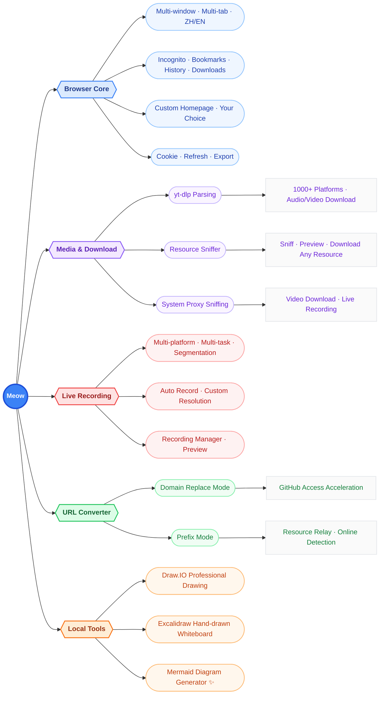

<div align="center">


# Meow Browser (🐱)

[]()
[]()
[]()

A modern Chromium-based browsing environment where you define your homepage layout, grab resources from anywhere, and run local tools securely offline.

🔑 **Keywords**: yt-dlp · Video Download · Live Recording · VIP Video Parsing · WeChat Channels Download · Resource Sniffer · Mermaid Editor · Offline Tools · PDF Editor · URL Converter

</div>


---

## 📖 Introduction

Meow Browser — a modern Chromium-based browsing environment, fully compatible with all kinds of websites, balancing convenience and privacy.

> **Your homepage layout, your call**: Minimal mode, freely toggleable features, custom shortcuts, tab stashing, and bookmark pinning — everything you need.
>
> **Multiple engines to grab resources effortlessly**: yt-dlp parsing, resource sniffing, live recording, proxy sniffing, and URL conversion — resources from all over the web are within reach.
>
> **Extensible local web tools**: Excalidraw, Mermaid, Draw.io, PDFCraft — all run locally, work offline, and never upload your data.
>
> **Polished browser core features**: Multi-tab, bookmark management, history, and download management — take full control of your browsing data.

- 🎬 **Bilibili Demos**: [space.bilibili.com/247302096](https://space.bilibili.com/247302096)
- 🌐 **Official Website**: [shawn.free.nf](https://shawn.free.nf/)
- 📘 **User Guide**: [Meow User Guide -- From Download to Uninstall](https://shawn.free.nf/meow/)
- ⬇️ **Latest Release**: [Gitee Releases](https://gitee.com/shawn-wow/meow/releases)
- ⬇️ **Latest Release**: [GitHub Releases](https://github.com/shawn-wow/meow/releases/)

---

## ✨ Feature Overview

Meow's capabilities fall into five major modules:



---

## 🧭 Browser Core

Meow delivers a complete and modern browsing experience, supporting multi-window, multi-tab, bilingual (Chinese/English) interface, as well as incognito mode, bookmarks, history, and download management.

| Capability | Description |
| --- | --- |
| Multi-window / Multi-tab | Multi-window and multi-tab support; tabs can be grouped, pinned, muted, and reordered by drag |
| Bilingual (ZH/EN) | Freely switch the interface between Simplified Chinese and English |
| Incognito Mode | Independent private window that leaves no browsing traces |
| Bookmark Management | Tree bookmarks, folders, drag-to-reorder, overflow menu |
| History | Grouped by date, search, batch delete |
| Download Management | Progress, speed, time remaining, pause/resume/retry |
| Cookie Refresh | One-click clear cookies for the current site and reload the page, resolving login state issues and stale caches |
| Cookie Export | Export cookies of the current site or all sites as a Netscape-format file for use by other video download tools such as yt-dlp |
| English Site Preference | When you want to visit the original site instead of being auto-redirected to a localized version, switch to English-first Accept-Language request headers with one click |
| Mobile Compatibility Mode | Switch to a mobile User-Agent for better visuals and layout when visiting mobile web pages |
| Custom Homepage | Customizable new tab page with freely toggleable sections and on-demand minimal mode |


### New Tab: My Browser, My Way

> **Customize your browser**: Homepage sections can be toggled on or off at will — if it feels cluttered, switch to minimal mode in one click.

The new tab page adopts a **modular, free layout** — toggle each section on or off from the control panel in the top-right corner, truly making it "my browser, my way".

- 🎛️ **Control Panel**: Theme color, light/dark/follow-system, interface language, background image, minimal mode, and visibility toggles for every section — all centralized here.
- 🧹 **Minimal Mode**: Hide all sections in one click, leaving only the logo and search box for focused browsing.
- 🖼️ **Background Image**: Supports Bing daily image, random switching, or turning it off.


> The control panel also provides quick access to **History / Bookmarks / Downloads / Live Recording / Settings**, plus actions like "Clear browsing data" and "Support the author".

#### 🛠️ Local Tools

> Web tools, running locally. Works offline, data never uploads — no anxiety about "server downtime". Import your local static assets and Meow becomes your web server.

Integrates productivity tools such as Mermaid, Draw.IO, Excalidraw, and PDFCraft — all running locally, no internet needed, data never leaves your device. Supports online install, update, uninstall, and manual import of custom WebApp archives. See the "Local Tools" section below for details.

#### ⭐ My Shortcuts

> Pin frequently visited sites from your bookmarks to the homepage for quicker access.

Displays commonly used sites as folders — click to open. Supports:

- **Add from Bookmarks**: Click "+ Add from Bookmarks", select a bookmark folder, and a shortcut block is generated on the homepage.
- **Quick Access**: Add the currently open tab to quick access with one click for temporary favorites.
- **Open All at Once**: Each folder supports "Open All" to launch every site in new tabs.
- **Sub-folder Navigation**: Click a sub-folder inside a folder to jump directly to its block, or add the sub-folder as a new shortcut.


#### 💎 My Treasures

> Lay out all the dust-collecting gems from your bookmarks on the homepage — you might be reminded of something.

A visual tiled view of your bookmarks, making everything visible at a glance. Supports:

- **Switch Bookmark Root**: Toggle between "Bookmarks Bar", "Other Bookmarks", and "Mobile Bookmarks".
- **Expand / Collapse All**: Quickly control the expanded state of all folders.
- **Collapsed Preview**: When collapsed, preview the icons of the first N bookmarks; N is customizable (0~20).
- **Folder Jump**: Click a sub-folder or parent folder to smoothly scroll to its position and highlight it.

#### 📑 Stashed Tabs

> Opened a ton of tabs but don't want to close them yet find it laggy? Stash them away in one click to free up memory and speed things up — restore them anytime.

Stash currently open tabs to review later, freeing up tab bar space. Supports:

- **Create a Stash Session**: Click "+ Add", select the tabs to stash (all selected by default), customize the session name, and the selected tabs are automatically closed and saved to the stash.
- **Quick Access**: You can also stash tabs to "Quick Access" for easy retrieval.
- **Restore All**: Restore all tabs in a session in one click and clear that stash.
- **Restore Individual**: Click a single tab in a session to restore it and remove it from the stash; middle-click to restore in the background.
- **Auto Deduplication**: Automatically filter out duplicate URLs (ignoring hash) when stashing.


#### 🔥 Popular Sites

A categorized directory of commonly used websites covering AI, video, social, news, knowledge, and more — one click to reach. Each category can be collapsed independently.

#### 🧩 Widgets

A draggable, reorderable dashboard of widgets, including by default:

- **Useful Navigations**: Quick links to maps, 12306, email, cloud storage, and other practical sites
- **Software Downloads**: Download links for WeChat, QQ, DingTalk, WPS, and other common software
- **QR Code**: Generate a QR code by entering text


### Bookmarks, History, and Downloads


---

## 🎥 Media & Download

Meow ships with multiple resource acquisition channels, doing its best to ensure your favorite videos can rest on your hard drive. **"Meow's ultimate secret!"**

> 🏆 **Meow natively supports cookies — no extra configuration needed for downloads**
>
> As a download tool powered by a browser engine, Meow naturally shares the browser's login state and cookies. As long as you can browse membership content normally in Meow, you can reuse existing cookies directly when downloading — no need to manually grab, import, or configure cookie files from a browser like other download tools. Of course, if you prefer your existing download tools, Meow's "one-click cookie export" can serve you too.

### Video / Audio Parsing & Download (yt-dlp)

Powered by the yt-dlp parsing engine, supporting one-click download of video and audio from **1000+** domestic and international platforms.

- **Domestic Platforms**: Tencent Video, Youku, Sohu, AcFun, Bilibili, Xiaohongshu, Douyin, Kuaishou, Xigua, Zhihu, Weibo, CCTV, MangoTV, Pear Video...
- **International Platforms**: YouTube, DailyMotion, Vimeo, VKontakte, TikTok, Facebook, Twitch, Snapchat...

### Resource Sniffer

Click the sniffer button, refresh the page, and listen to HTTP requests in real time — audio and video resource links are automatically filtered out, saving you the hassle of repeatedly pressing F12 + F5.

- **Online Preview**: Captured resources support online preview; usually if it previews, it can be downloaded.
- **Super Sniffer**: Performs a comprehensive analysis and deep search across multiple page requests, potentially uncovering more resource links (results not guaranteed).


### System Proxy Sniffing

Set Meow as the system proxy server to grab resources from platforms that browsers cannot directly access (such as **WeChat Channels**). First-time use requires installing a proxy certificate as prompted; the proxy closes automatically when Meow is shut down normally.

> ⚠️ Starting the proxy may affect sniffer downloads. It is recommended to enable it only when grabbing resources from special platforms. If Meow is force-closed leaving the proxy behind, restart Meow and then close the proxy, or manually disable the system proxy in your OS settings.


### Which Method to Choose?

| Priority | Method | Description |
| --- | --- | --- |
| 🥇 First Choice | yt-dlp parsing, proxy sniffing (special platforms) | Usually higher video quality |
| 🥈 Second Choice | Sniffer | Grabs page resource links |
| 🥉 Third Choice | Deep Search | Grabs more page resource links, more results to filter |

> Platforms continuously update their technical architecture. Some methods may temporarily fail — try a few approaches.

---

## 🎙️ Live Recording

Click "Live Recording" on supported live platform pages to save live content in real time, for playback, editing, or archiving.

- **Multi-platform Coverage**: Bilibili, Douyin, Kuaishou, Taobao, Huya, Douyu, YY, AcFun, WeChat Mini Programs, Twitch, TikTok (continuously expanding)
- **Multi-task Parallel Recording**: Record multiple live rooms simultaneously (parallel count limited by PC performance and network bandwidth)
- **Custom Resolution**: Choose from Original, HD, SD as needed
- **Smart Auto-Recording**: After enabling auto mode, monitor the streamer's status in real time and start recording when they go live
- **Smart Segmentation**: Recording data is segmented at fixed intervals and written to disk as it is generated, reducing memory peaks; automatically stitched in order upon completion, enabling long recordings with "zero lag, zero loss"
- **Easy Management**: Freely remove live rooms and view/delete recorded files on the recording management page


---

## 🔀 URL Converter

> When a resource cannot be accessed directly, load it via an alternative site automatically. Supports custom conversion rules.

The URL Converter enables convenient resource access through rule conversion, supporting two modes — **Domain Replace** and **Prefix** — along with online status detection, smart filtering, and custom configuration.

- **Domain Replace (Replace)**: Replace the original link's domain with a specified mirror site. Often used to configure accelerated access to sites like GitHub, e.g. `github.com -> github1s.com`.
- **Prefix (Prefix)**: Prepend a specified prefix to the original link. Often used to configure video parsing routes.


### Key Features

| Feature | Description |
| --- | --- |
| Online Detection | One-click check the availability of all relay routes (available / unavailable / offline / unchecked) |
| Smart Filtering | Smart mode prioritizes matching domain-replace routes and available prefix routes |
| Batch Management | Batch-delete unavailable or offline routes by filter conditions |
| Custom Config | Manually edit routes, supporting `DomainA -> DomainB` (replace) or entering a prefix URL directly (prepend) |
| Remote Sync | One-click refresh the latest relay routes from remote; custom local routes are preserved |

### Current Relay Routes Example

Relay route data comes from a remote configuration file. Below is a sample of the current `relay.txt` content (video parsing routes are frequently shut down due to copyright issues — regular online detection and filtering is recommended):

Remote data source URL — click "Refresh" in "Config" to get the latest routes:

```
https://raw.giteeusercontent.com/shawn-wow/meow/raw/master/relay.txt
```

#### Domain Replace (Replace)

```
# Code Online Reading / Tools
github.com -> github1s.com
github.com -> github.dev
github.com -> stackblitz.com/github
github.com -> gitdiagram.com
github.com -> deepwiki.com
github.com -> zread.com
github.com -> gitreverse.com
github.com -> gitingest.com
gitee.com -> gitee1s.com

# GitHub Mirror Acceleration
github.com -> kkgithub.com
raw.githubusercontent.com -> cdn.jsdelivr.net/gh
codeload.github.com -> codeload.kkgithub.com

# Lightweight Content Reading
medium.com -> readmedium.com
reddit.com -> old.reddit.com
weibo.com -> m.weibo.cn
toutiao.com -> m.toutiao.com

# Academic Papers
arxiv.org -> ar5iv.labs.arxiv.org
```

#### Prefix (Prefix / Video Parsing)

```
https://jiexi.789jiexi.com/?url=
https://jiexi.789jiexi.net:4433/?url=
https://jiexi.789jiexi.icu:4433/?url=
https://jx.789jiexi.icu:4433/?url=
https://www.8090g.cn/?url=
https://bd.jx.cn/?url=
https://jiexi.site/?url=
https://z1.m1907.top?jx=
https://bfq.txnp.cn/player?url=
https://art.txnp.cn/?url=
https://free.maccms.xyz/?url=
https://im1907.top/?jx=
https://www.66dpw.vip/?url=
https://video.isyour.love/player/getplayer?url=
https://jx.202617.xyz/tv.php?url=
https://jx.nodenode.dpdns.org/?url=
https://jx.xmflv.com/?url=
https://yparse.ik9.cc/index.php?url=
https://jx.77flv.cc/?url=
https://player.maqq.cn/?url=
https://jx.hls.one/?url=
```

> ⚠️ **Safety Notice**: Relay parsing routes may carry ads, pop-ups, redirects, or deceptive download prompts. Please exercise caution, do not enter sensitive information such as account credentials, and use at your own risk.

---

## 🛠️ Local Tools

> **Runs locally · Works offline · No login required · Data never uploads**
>
> Web tools, running locally. Works offline, data never uploads — no anxiety about "server downtime". Import your local static assets and Meow becomes your web server.

Meow ships with several offline productivity tools — no internet, no login, all data stays local, works offline, safe and reliable.

### Mermaid Diagram Generator ✨

Draw flowcharts, sequence diagrams, class diagrams, state diagrams, ER diagrams, Gantt charts, mind maps, architecture diagrams, kanban charts, radar charts, sankey diagrams, and dozens more using text syntax. Supports theme switching, hand-drawn mode, zoom/pan, grid, canvas background, margins, and layout direction.


**Core capabilities:**

- **Local File-Associated Editing**: Unlike most online Mermaid editors that only support "export/save as", Meow lets you directly open local `mermaid` files like a Word document, and `Ctrl+S` overwrites the original file — no repetitive import/export. Supports `Ctrl+O` to open, `Ctrl+N` for new, `Ctrl+Shift+S` for save-as, and automatically maintains a list of the 10 most recently opened files for quick revisit.
- **On-Screen Syntax Reference**: Built-in official syntax documentation for 30+ diagram types (flowchart, sequence, class, state, ER, Gantt, mind map, kanban, radar, sankey, architecture, C4, etc.), displayed alongside the editor — **no need to switch windows to look up docs**. Even better, it auto-detects the current diagram type from your code and switches to the corresponding syntax reference. Bilingual (ZH/EN) toggleable, and example code in the docs supports one-click copy.
- **Official Examples**: Built-in `@mermaid-js/examples` official example library covering flowcharts, class diagrams, sequence diagrams, ER diagrams, state diagrams, mind maps, and more. Some diagram types offer multiple examples selectable via dropdown — load with one click, the perfect starting point for learning Mermaid syntax.
- **Draft Mode**: An independent top-bottom split editing space — live preview on top, code editing below, with draggable ratio (presets 3:7 / 5:5 / 7:3) and zoomable/pannable canvas. When satisfied, click "Apply" to send to the main editor, or mark as a history version, or close and discard. The ideal place to experiment without polluting the main canvas.
- **Edit History**: Two views — "Timeline" and "Marked". The timeline auto-records every saved version, ordered by relative time (just now, X minutes ago, X hours ago, X days ago); the Marked view is for manually bookmarking important versions. Each history entry supports restore, copy code, open in new tab, rename, delete, and one-click clear of the current view.
- **Export & Copy**: Before exporting, fine-tune image size (auto / specified width / custom width & height), DPI (72 web / 96 default / 150 good print / 300 HD print / 600 ultra HD), and canvas background (solid / transparent). Supports copying PNG image, SVG code, or Markdown to clipboard, or downloading as SVG, PNG, JPEG, WebP, PDF, or Markdown files — covering document embedding, print publishing, and more.

### Draw.IO Professional Drawing

Integrates diagrams.net (draw.io), supporting flowcharts, architecture diagrams, UML, network diagrams, mind maps, and other professional charting.


### Excalidraw Hand-drawn Whiteboard

A hand-drawn style infinite whiteboard, perfect for quick sketches, wireframes, and brainstorming.


### PDFCraft All-in-One PDF Editor

A comprehensive PDF processing tool with full features, all running locally:

- **Page Operations**: Merge, split, organize, delete, rotate, and extract pages
- **Content Editing**: Annotations, e-signatures, watermarks, reorder pages
- **Format Conversion**: PDF ⇄ Word
- **Size Optimization**: Compress PDF file size


---

## ⚙️ Settings

Centralized management of all configurations: appearance themes (light/dark/follow system), theme colors (18 curated theme colors, plus custom colors), address bar and search engine, startup page, privacy and data cleanup, about and sponsor the author, and more.


---

## ⚖️ Copyright Notice

The convenient local video storage feature provided by this software is intended to help you collect personally favorite video materials or obtain legal creative materials. **It is for learning and communication purposes only — do not use it for illegal purposes.** We firmly oppose and prohibit any illegal use.

Although this software provides the ability to download videos from various platforms, you are responsible for respecting and complying with relevant laws and regulations as well as the copyright policies of video platforms and content creators. It is strongly recommended to limit downloaded content to personal appreciation and learning, and to delete it within 24 hours of download. You are encouraged to visit the original publishing websites of the resources to watch and support original works. Do not use for any other purpose without explicit authorization from the original author.

---

## 📮 Contact & Support

- **Code Repository**: [Gitee: shawn-wow/meow](https://gitee.com/shawn-wow/meow)
- **Updates**: In-app update notifications or manual update check (note: open-source code is no longer updated, the software package continues to be updated)
- **Community**: Bilibili [九漏非鱼](https://space.bilibili.com/247302096)

---

# Development Guide

## Development & Running

Before running Meow, make sure your machine has the **latest** [`Node.js`](https://nodejs.org/) and [`Yarn`](https://yarnpkg.com/) installed.

This project does **not** support NPM — Yarn is required (currently locked to `yarn@4.18.1`, see the `packageManager` field in `package.json`).

### Install Dependencies

```bash
yarn install
```

### Start Development Mode

```bash
yarn dev
```

Development mode launches both the renderer process (Vite) and the main process (webpack watch), and opens the app automatically.

### Build

```bash
yarn build
```

Compiles the main and renderer process code and generates asset hashes.

### Run the Built Version

```bash
yarn start
```

## Packaging & Release

```bash
yarn windows   # Build the Windows version
yarn linux     # Build the Linux version
yarn darwin    # Build the macOS version (universal)
```

## Other Commands

```bash
yarn lint        # Run ESLint and Prettier checks
yarn fixlint     # Run checks and auto-fix
yarn copyright   # Generate copyright headers for source files
yarn rebuild     # Rebuild Electron native dependencies
yarn rmb         # Clean build artifacts
yarn nuke        # Clean node_modules
```

See [`package.json`](package.json) for more commands.

### Windows Environment Notes

Make sure C++ build tools are installed. Install them with the following command as **Administrator**:

```bash
npm i -g windows-build-tools
```