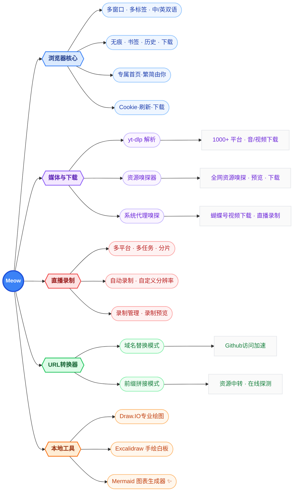

<div align="center">


# Meow 浏览器（🐱）

[]()
[]()
[]()

基于 Chromium 的现代浏览环境，首页布局由你定义，全网资源轻松拿捏，本地工具安全离线。

🔑 **关键词**：yt-dlp · 视频下载 · 直播录制 · VIP视频解析 · 视频号下载 · 资源嗅探 · Mermaid 编辑器 · 离线工具 · PDF 编辑 · URL 转换

</div>


---

## 📖 简介

Meow 浏览器 —— 基于 Chromium 的现代浏览环境，全面兼容各类网站，兼顾便捷与私密。

> **首页布局由你定义**：极简模式、功能自由开关、自定义快捷方式、标签暂存、书签平铺，一应俱全。
>
> **多种引擎助你轻松获取资源**：yt-dlp 解析、资源嗅探、直播录制、代理嗅探、URL 转换，全网资源唾手可得。
>
> **可扩展的本地化 Web 工具**：Excalidraw、Mermaid、Draw.io、PDFCraft，全部本地运行，断网也能用，数据不上传。
>
> **精心打磨的浏览器核心功能**：多标签、书签管理、历史记录、下载管理，让你更高效地掌控浏览数据。

- 🎬 **B站视频演示**：[space.bilibili.com/247302096](https://space.bilibili.com/247302096)
- 🌐 **官方网站**：[shawn.free.nf](https://shawn.free.nf/)
- 📘 **用户指北**：[Meow 用户指北 -- 从下载到删除](https://shawn.free.nf/meow/)
- ⬇️ **最新版本下载**：[Gitee Releases](https://gitee.com/shawn-wow/meow/releases)
- ⬇️ **最新版本下载**：[GitHub Releases](https://github.com/shawn-wow/meow/releases)

---

## ✨ 功能一览

Meow 的能力可归纳为五大模块：



---

## 🧭 浏览器核心

Meow 提供完整而现代的浏览体验，支持多窗口、多标签页、中英文双语界面，以及无痕浏览、书签、历史记录、下载管理等标准浏览器能力。

| 能力 | 说明 |
| --- | --- |
| 多窗口 / 多标签 | 支持多窗口与多标签页，标签可分组、固定、静音、拖拽排序 |
| 中英文双语 | 界面在简体中文与英文间自由切换 |
| 无痕模式 | 独立的隐身窗口，不留下浏览痕迹 |
| 书签管理 | 树形书签、文件夹、拖拽排序、溢出菜单 |
| 历史记录 | 按日期分组、搜索、批量删除 |
| 下载管理 | 进度、速度、剩余时间、暂停/继续/重试 |
| Cookie 刷新 | 一键清除当前站点的 Cookie 并刷新页面，解决登录态异常、页面缓存等问题 |
| Cookie 下载 | 导出当前站点或全部站点的 Cookie 为 Netscape 格式文件，供 yt-dlp 等其它视频下载工具使用 |
| 英文站点 | 若想访问原始站点而非自动跳转到本地语言版本，可一键切换为英文优先的 Accept-Language 请求头 |
| 移动端兼容模式 | 切换为移动端 User-Agent，访问移动版网页时获得更好的视觉效果与布局适配 |
| 专属首页 | 可定制新标签页，区块自由开关、极简模式随心切换 |


### 新标签页：我的浏览器我定义

> **自定义你的浏览器**：首页内容想开就开、想关就关，嫌乱就一键切换极简模式。

新标签页采用**模块化自由布局**，通过右上角控制面板一键开关各个区块，真正做到「我的浏览器我定义」。

- 🎛️ **控制面板**：主题色、浅色/深色/跟随系统、界面语言、背景图、极简模式，以及各区块显隐开关，全部集中在这里。
- 🧹 **极简模式**：一键隐藏所有区块，只留下 logo 与搜索框，专注浏览。
- 🖼️ **背景图**：支持 Bing 每日一图，也可随机切换或关闭。


> 控制面板还提供**历史 / 书签 / 下载 / 直播录制 / 设置**的快捷入口，以及「清除浏览数据」「支持作者」等操作。

#### 🛠️ 本地工具

> 网页工具，本地化运行。断网也能用，数据不上传，无「服务器挂了」的焦虑。导入你的本地静态资源，Meow 就是你的 Web 服务器。

集成 Mermaid、Draw.IO、Excalidraw、PDFCraft 等生产力工具，全部本地运行、无需联网、数据不上传。支持在线安装、更新、卸载，以及手动导入自定义 WebApp 归档。详见后文「本地工具」章节。

#### ⭐ 我的快捷方式

> 从收藏夹里将常访问的网站钉在首页，访问更便捷。

将常用网站以文件夹形式平铺展示，点击即开。支持：

- **从书签添加**：点击「+ 从书签添加」，选择书签文件夹即可在首页生成快捷方式区块。
- **快捷访问**：将当前打开的标签页一键加入快捷访问，方便临时收藏。
- **一键打开全部**：每个文件夹支持「全部打开」，批量在新标签页中打开。
- **子文件夹联动**：在文件夹内点击子文件夹可直接跳转到对应区块，也可将子文件夹添加为新的快捷方式。


#### 💎 我的宝藏

> 把你收藏夹里所有吃灰的宝贝平铺到首页，或许你会想起点什么。

书签的可视化平铺视图，让书签一目了然。支持：

- **切换书签根目录**：可在「书签栏」「其它书签」「移动设备书签」之间切换显示。
- **一键展开/折叠全部**：快速控制所有文件夹的展开状态。
- **折叠预览**：折叠状态下可预览前 N 个书签的图标，N 可自定义（0~20）。
- **文件夹跳转**：点击子文件夹或父文件夹可平滑滚动到对应位置并高亮。

#### 📑 暂存标签

> 开了一大堆网页不想关又嫌卡，一键把它们暂时收起来，释放内存提速，随时一键恢复。

将当前打开的标签页暂存起来，稍后再看，释放标签栏空间。支持：

- **新建暂存会话**：点击「+ 添加」，勾选要暂存的标签页（默认全选），可自定义会话名称，确认后所选标签页自动关闭并保存到暂存区。
- **快捷访问**：也可将标签页暂存到「快捷访问」，方便快速找回。
- **恢复全部**：一键恢复整个会话的所有标签页，并清空该暂存。
- **单个恢复**：点击会话中的单个标签即可恢复并从暂存中移除；中键点击可在后台恢复。
- **自动去重**：暂存时自动过滤相同 URL（忽略 hash），避免重复。


#### 🔥 热门站点

按分类整理的常用网站导航，覆盖AI、视频、社交、资讯、知识百科等多个领域，点击即达。每个分类可独立折叠。

#### 🧩 小部件

可拖拽排序的仪表盘小组件，默认包含：

- **常用导航**：地图、12306、邮箱、网盘等实用网站快捷入口
- **软件下载**：微信、QQ、钉钉、WPS 等常用软件下载链接
- **二维码**：输入文字即可生成二维码


### 书签、历史与下载


---

## 🎥 媒体与下载

Meow 内置多种资源获取渠道，尽最大能力保障你喜欢的视频资源能够躺在硬盘里吃灰。**「Meow 的终极奥义！」**

> 🏆 **Meow 天然支持 Cookie，下载资源无需额外配置**
>
> 作为浏览器内核驱动的下载工具，Meow 天然共享浏览器的登录态与 Cookie。只要你能在 Meow 中正常浏览会员内容，下载时就能直接复用已有的 Cookie，无需像其它下载工具那样先从浏览器手动抓取、导入或配置 Cookie 文件。当然，如果你更偏爱现有的下载工具，Meow 的「一键下载 Cookie」也可以为你所用。

### 视频 / 音频解析下载（yt-dlp）

基于 yt-dlp 解析引擎，支持 **1000+** 国内外平台的视频与音频一键下载。

- **国内平台**：腾讯视频、优酷、搜狐、A站、B站、小红书、抖音、快手、西瓜、知乎、微博、央视频、芒果TV、梨视频……
- **国际平台**：YouTube、DailyMotion、Vimeo、VKontakte、TikTok、Facebook、Twitch、Snapchat……

### 资源嗅探器

点击嗅探器按钮，刷新页面并实时监听 HTTP 请求，自动筛选出音视频资源链接，省去反复 F12 + F5 的繁琐操作。

- **在线预览**：捕获到的资源支持在线预览，通常可预览即可下载。
- **超级嗅探器**：对页面多次请求进行全面分析与深度搜索，可能挖掘出更多资源链接（结果非绝对）。


### 系统代理嗅探

将 Meow 设为系统代理服务器，可获取某些浏览器无法直接访问的平台资源（如 **蝴蝶号**）。首次使用需按提示安装代理证书，Meow 正常关闭时代理自动关闭。

> ⚠️ 启动代理可能影响嗅探器下载，建议仅在获取特殊平台资源时开启。若 Meow 被强制关闭导致代理残留，可重启 Meow 后关闭代理，或在操作系统中手动关闭系统代理。


### 资源获取姿势怎么选？

| 优先级 | 方式 | 说明 |
| --- | --- | --- |
| 🥇 首选 | yt-dlp 解析、代理嗅探（特殊平台） | 视频质量通常较高 |
| 🥈 次选 | 嗅探器 | 抓取页面资源链接 |
| 🥉 再选 | 深度搜索 | 抓取页面资源链接，结果更多需筛选 |

> 各平台技术架构持续迭代，部分方式可能临时失效，请多尝试几种姿势。

---

## 🎙️ 直播录制

在支持的直播平台页面点击「直播录制」，实时保存直播内容，满足回看、剪辑或存档需求。

- **多平台覆盖**：哔哩哔哩、抖音、快手、淘宝、虎牙、斗鱼、YY、AcFun、微信小程序、Twitch、TikTok（持续扩展中）
- **多任务并行录制**：同时录制多个直播间（并行数受限于电脑性能与网络带宽）
- **自定义分辨率**：原画、高清、标清按需选择
- **智能自动录制**：开启自动模式后实时监测主播状态，开播即录
- **智能分片**：录制数据按固定时间间隔分片并边生成边写入磁盘，降低内存峰值；结束后自动按序拼接，实现「零卡顿、零丢失」的长时间录制
- **便捷管理**：在录制管理页面自由移除直播间、查看和删除录播文件


---

## 🔀 URL 转换器

> 当资源无法直接访问时，自动通过替代站点加载。支持自定义转换规则。

URL 转换器通过规则转换实现便捷的资源访问，支持**域名替换（Replace）**与**前缀拼接（Prefix）**两种模式，并具备在线状态探测、智能筛选与自定义配置能力。

- **域名替换（Replace）**：将原链接的域名替换为指定镜像站。常用于配置 GitHub 等站点的加速访问，例如 `github.com -> github1s.com`。
- **前缀拼接（Prefix）**：在原链接前拼接指定前缀。常用于配置视频解析线路。


### 主要特性

| 特性 | 说明 |
| --- | --- |
| 在线探测 | 一键检测所有中转线路的可用状态（可用 / 不可用 / 离线 / 未检测） |
| 智能筛选 | 智能模式优先展示匹配的域名替换线路与可用的前缀线路 |
| 批量管理 | 按筛选条件批量删除不可用或离线线路 |
| 自定义配置 | 手动编辑线路，支持 `域名A -> 域名B`（替换）或直接填写前缀 URL（拼接） |
| 远程同步 | 一键从远程刷新最新中转线路，自定义的本地线路会被保留 |

### 当前中转线路示例

中转线路数据来源于远程配置文件，以下为 `relay.txt` 的当前内容示例（视频解析线路因版权问题经常关停，建议定期在线探测筛选）：

远程数据源地址，可在「配置」中点击「刷新」获取最新线路：

```
https://raw.giteeusercontent.com/shawn-wow/meow/raw/master/relay.txt
```

#### 域名替换（Replace）

```
# 代码在线阅读 / 工具
github.com -> github1s.com
github.com -> github.dev
github.com -> stackblitz.com/github
github.com -> gitdiagram.com
github.com -> deepwiki.com
github.com -> zread.com
github.com -> gitreverse.com
github.com -> gitingest.com
gitee.com -> gitee1s.com

# GitHub 镜像加速
github.com -> kkgithub.com
raw.githubusercontent.com -> cdn.jsdelivr.net/gh
codeload.github.com -> codeload.kkgithub.com

# 内容轻量阅读
medium.com -> readmedium.com
reddit.com -> old.reddit.com
weibo.com -> m.weibo.cn
toutiao.com -> m.toutiao.com

# 学术论文
arxiv.org -> ar5iv.labs.arxiv.org
```

#### 前缀拼接（Prefix / 视频解析）

```
https://jiexi.789jiexi.com/?url=
https://jiexi.789jiexi.net:4433/?url=
https://jiexi.789jiexi.icu:4433/?url=
https://jx.789jiexi.icu:4433/?url=
https://www.8090g.cn/?url=
https://bd.jx.cn/?url=
https://jiexi.site/?url=
https://z1.m1907.top?jx=
https://bfq.txnp.cn/player?url=
https://art.txnp.cn/?url=
https://free.maccms.xyz/?url=
https://im1907.top/?jx=
https://www.66dpw.vip/?url=
https://video.isyour.love/player/getplayer?url=
https://jx.202617.xyz/tv.php?url=
https://jx.nodenode.dpdns.org/?url=
https://jx.xmflv.com/?url=
https://yparse.ik9.cc/index.php?url=
https://jx.77flv.cc/?url=
https://player.maqq.cn/?url=
https://jx.hls.one/?url=
```

> ⚠️ **安全提示**：中转解析线路可能夹带广告、弹窗、跳转或诱导下载，请谨慎甄别，勿输入账号密码等隐私信息，风险自担。

---

## 🛠️ 本地工具

> **本地运行 · 离线可用 · 无需登录 · 数据不上传**
>
> 网页工具，本地化运行。断网也能用，数据不上传，无「服务器挂了」的焦虑。导入你的本地静态资源，Meow 就是你的 Web 服务器。

Meow 内置多款离线生产力工具，无需联网、无需登录，数据全部留在本地，断网也能用，安全可靠。

### Mermaid 图表生成器 ✨

通过文本语法快速绘制流程图、时序图、类图、状态图、ER 图、甘特图、思维导图、架构图、看板图、雷达图、桑基图等数十种图表，支持主题切换、手绘模式、缩放平移、网格、画布背景、边距与布局方向等可视化调节。


**核心能力：**

- **本地文件关联编辑**：与绝大多数只能"导出/另存为"的在线 Mermaid 编辑器不同，Meow 支持像 Word 一样直接打开本地 `mermaid` 文件，编辑后 `Ctrl+S` 直接覆盖保存原文件，无需反复导入导出。支持 `Ctrl+O` 打开、`Ctrl+N` 新建、`Ctrl+Shift+S` 另存为，并自动维护最近打开的 10 个文件列表，一键快速回访。
- **同屏语法参考**：内置 30+ 种图表的官方语法文档（流程图、时序图、类图、状态图、ER 图、甘特图、思维导图、看板图、雷达图、桑基图、架构图、C4 图等），与编辑器同屏显示，**无需切窗口查文档**。更贴心的是，它会根据你当前编辑的代码自动识别图表类型并切换到对应的语法参考，中英文双语可随时切换，文档中的示例代码支持一键复制。
- **官方案例**：内置 `@mermaid-js/examples` 官方示例库，覆盖流程图、类图、时序图、ER 图、状态图、思维导图等主流图表类型，部分图表提供多个示例可下拉切换，一键加载即用，是学习 Mermaid 语法的最佳起点。
- **草稿模式**：独立的上下分栏编辑空间——上方实时预览、下方代码编辑，支持拖拽调整比例（预设 3:7 / 5:5 / 7:3），画布可缩放平移。编辑满意后一键「应用」到主编辑器，也可直接标记为历史版本或关闭丢弃，是试验新想法不污染主画布的理想场所。
- **编辑历史**：分为「时间线」和「标记」两个视图。时间线自动记录每次保存的版本，按相对时间（刚刚、X 分钟前、X 小时前、X 天前）排列；标记视图用于手动收藏重要版本。每条历史支持恢复、复制代码、在新标签页打开、重命名、删除，并可一键清空当前视图。
- **导出与复制**：导出前可精细调整图像尺寸（自动/指定宽度/自定义宽高）、DPI（72 网页 / 96 默认 / 150 良好打印 / 300 高清打印 / 600 超高清）以及画布背景（纯色/透明）。支持复制 PNG 图片、SVG 代码、Markdown 到剪贴板，或下载为 SVG、PNG、JPEG、WebP、PDF、Markdown 文件，满足文档嵌入、印刷出版等多种场景。

### Draw.IO 专业绘图

集成 diagrams.net（draw.io），支持流程图、架构图、UML、网络图、思维导图等专业图表绘制。


### Excalidraw 手绘白板

手绘风格的无限白板，适合快速草图、线框图、头脑风暴。


### PDFCraft 一站式 PDF 编辑器

一站式 PDF 处理工具，功能齐全且全部本地运行：

- **页面操作**：合并、拆分、整理、删除、旋转和提取页面
- **内容编辑**：批注、电子签名、水印、调整页面顺序
- **格式转换**：PDF 与 Word 互转
- **体积优化**：压缩 PDF 文件大小


---

## ⚙️ 设置

集中管理外观主题（浅色/深色/跟随系统）、主题颜色（精选18套主题色、你也可以自定义颜色）、地址栏与搜索引擎、启动页、隐私与数据清理、关于与赞助作者等所有配置。


---

## ⚖️ 版权说明

本软件提供的便捷本地视频存储功能，旨在方便你收集个人喜爱的视频资料或获取合法创作素材，**仅供学习交流使用，请勿用于非法用途**。我们坚决反对并禁止任何非法用途。

虽然本软件提供从各平台下载视频的能力，但你有责任尊重并遵守相关法律法规及各视频平台或内容创作者的版权政策。强烈建议将下载内容仅限于个人欣赏与学习，并在下载后 24 小时内及时删除。鼓励访问资源的原始发布网站进行观看并支持原创作品，未经原作者明确授权，请勿用于其它任何目的。

---

## 📮 联系与支持

- **代码仓库**：[Gitee: shawn-wow/meow](https://gitee.com/shawn-wow/meow)
- **版本更新**：软件内提示更新或手动检查更新（注：开源代码不再更新，软件包持续更新中）
- **使用交流**：B站 [九漏非鱼](https://space.bilibili.com/247302096)

---

# 开发指南

## 开发运行

运行 Meow 前，请确保你的机器已安装**最新版** [`Node.js`](https://nodejs.org/zh-cn/) 和 [`Yarn`](https://yarnpkg.com/)。

本项目**不支持** NPM，需要使用 Yarn（当前锁定版本为 `yarn@4.18.1`，参见 `package.json` 的 `packageManager` 字段）。

### 安装依赖

```bash
yarn install
```

### 启动开发模式

```bash
yarn dev
```

开发模式会同时启动渲染进程（Vite）与主进程（webpack watch），并自动打开应用。

### 构建

```bash
yarn build
```

编译主进程与渲染进程代码，并生成资源哈希。

### 运行已构建版本

```bash
yarn start
```

## 打包发布

```bash
yarn windows   # 打包 Windows 版本
yarn linux     # 打包 Linux 版本
yarn darwin    # 打包 macOS 版本（通用包）
```

## 其它命令

```bash
yarn lint        # 运行 ESLint 与 Prettier 检查
yarn fixlint     # 运行检查并自动修复
yarn copyright   # 为源码文件生成版权头
yarn rebuild     # 重建 Electron 原生依赖
yarn rmb         # 清理构建产物
yarn nuke        # 清理 node_modules
```

更多命令可查看 [`package.json`](package.json)。

### Windows 环境提示

请确保已安装 C++ 构建工具，可通过以下命令以**管理员身份**安装：

```bash
npm i -g windows-build-tools
```
